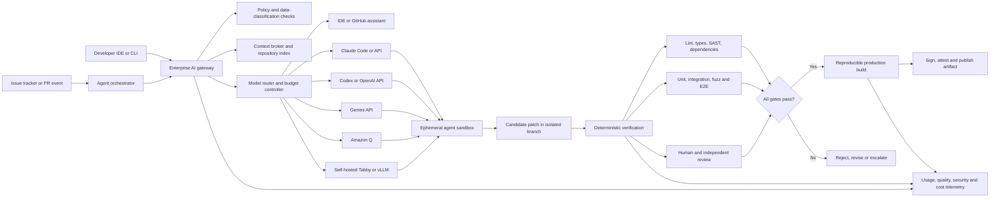

# AI-Assisted Code Completion and Application Completion Strategy for the Remainder of 2026

## Executive summary

As of **August 2, 2026**, the most reliable path to completing an unspecified application by the end of 2026 is not to select one “best” coding model. It is to establish a **controlled software-engineering system in which several assistants compete or specialize**, while deterministic builds, automated tests, security gates, and human ownership remain authoritative.

The recommended default architecture is:

1. **A primary IDE assistant** for low-latency completion and routine editing: GitHub Copilot Business or Enterprise when development is centered on GitHub; Cursor Teams when agent-oriented editing and multi-model choice matter more than native GitHub governance.
2. **One or two repository-level agents** for larger features, migrations, debugging, and multi-file work: Claude Code and OpenAI Codex are the leading candidates for a bake-off.
3. **A fast, economical model tier** for classification, documentation, test scaffolding, CI-log summarization, and mechanical transformations: a current Gemini Flash model or a smaller OpenAI model.
4. **Amazon Q Developer** when the application is AWS-heavy or requires its Java, .NET, SQL, or AWS modernization capabilities. Amazon CodeWhisperer should no longer be treated as a separate product; it became part of Amazon Q Developer on April 30, 2024. citeturn4search3turn4search7
5. **A self-hosted completion tier**—for example, Tabby backed by an approved open coding model and, for larger agent requests, vLLM—when source code cannot leave controlled infrastructure. Tabby is explicitly designed as a self-hosted coding assistant, while vLLM supplies OpenAI-compatible serving, quantization, prefix caching, distributed inference, and multi-LoRA support. citeturn6search5turn6search33turn5search2turn9search7
6. **A provider-neutral AI gateway** between automation and model providers. The gateway should enforce repository allowlists, redact secrets, select models, cap cost, record prompt and model versions, and support an immediate kill switch.

“Complete the application” should be defined operationally, not as “the agent says it is finished.” Completion means that every accepted requirement is traceable to code and tests; release builds are reproducible; known high-severity defects and vulnerabilities are resolved or formally accepted; deployment, rollback, observability, and operational documentation exist; and a human owner approves each production change.

This human-owned definition is necessary because public coding benchmarks do not establish that an assistant can autonomously finish a particular proprietary system. SWE-bench Verified is a human-validated set of 500 repository issues, SWE-Lancer covers more than 1,400 real freelance tasks, LiveCodeBench attempts to reduce contamination through continually refreshed problems, and Terminal-Bench measures long-horizon terminal work. Later research has also questioned how faithfully public benchmark performance transfers to realistic prompts, unseen repositories, and enterprise tasks. citeturn7search26turn7search1turn7search9turn7search12turn7search3turn7search10

Given the current date, the practical target is a **roughly twenty-week program ending December 18, 2026**, leaving the remainder of December as stabilization and contingency time. The highest-priority actions are to inventory the application, freeze a private evaluation set, establish security and data-handling rules, conduct a multi-assistant bake-off, deploy local assistance first, introduce read-only AI review in CI, and only then permit agents to create pull requests.

## Application inventory and readiness baseline

AI assistance is ineffective when the organization itself cannot answer basic questions about its repositories, build process, ownership, runtime dependencies, or definition of done. The first deliverable should therefore be an **application completion dossier**, not generated code.

A practical inventory process is:

1. **Locate every source repository and deployable unit.** Record primary repositories, submodules, monorepo packages, generated-code repositories, infrastructure-as-code, database migrations, mobile clients, browser clients, backend services, shared libraries, scripts, deployment definitions, and operational runbooks.
2. **Identify technology automatically, then verify manually.** Use file manifests, package managers, lockfiles, build files, container definitions, and CI configuration to determine languages, frameworks, compilers, runtime versions, package managers, test frameworks, linters, type checkers, and deployment targets.
3. **Map the architecture.** Identify entry points, public APIs, queues, scheduled jobs, data stores, third-party integrations, authentication boundaries, trust boundaries, and service-to-service dependencies.
4. **Establish build reproducibility.** Every component should have a documented clean-environment command that restores dependencies, builds, runs tests, and produces an artifact.
5. **Measure test and quality coverage.** Record unit, integration, contract, end-to-end, performance, accessibility, migration, and security-test coverage. Do not use line coverage alone as a quality proxy.
6. **Classify data and code.** Mark files and repositories as public, internal, confidential, regulated, export-controlled, customer-owned, or prohibited from external AI processing.
7. **Identify unfinished work.** Consolidate issue trackers, `TODO` and `FIXME` markers, failing tests, stubs, disabled features, unimplemented API methods, migration debt, deprecated dependencies, and operational gaps.
8. **Convert “unfinished” into an executable backlog.** Each work item should have acceptance criteria, impacted components, risk level, required tests, rollback implications, dependencies, and a human owner.

A compact inventory manifest can be stored in the repository:

```yaml
application:
  name: replace-me
  business_owner: replace-me
  technical_owner: replace-me
  target_completion_date: "2026-12-18"

repositories:
  - name: web-api
    location: "git-provider/org/repo"
    classification: confidential
    deployable: true
    languages: []
    frameworks: []
    build_command: ""
    test_commands: []
    lint_commands: []
    typecheck_commands: []
    security_commands: []
    artifact: ""
    deployment_target: ""
    production_slo: ""
    owners: []

architecture:
  entry_points: []
  public_interfaces: []
  data_stores: []
  external_integrations: []
  trust_boundaries: []
  critical_flows: []

ai_policy:
  external_processing_allowed: false
  allowed_providers: []
  prohibited_paths:
    - ".env*"
    - "**/secrets/**"
    - "**/customer_exports/**"
  agent_shell_access: approval-required
  agent_network_access: deny-by-default
  maximum_files_per_change: 20
  maximum_diff_lines_without_architect_review: 500
```

The initial baseline should include at least the following measurements:

| Baseline area | Required evidence | Why it matters for assistant selection |
|---|---|---|
| Repository scale | Files, source lines, packages, repository count and dependency graph | Determines whether local-file context is enough or repository retrieval is required |
| Languages and frameworks | Versioned language and framework inventory | Assistants differ materially across popular and niche languages |
| Build health | Clean checkout build pass rate and duration | Agents need a reliable feedback loop |
| Test health | Passing, failing, flaky and quarantined tests | A model cannot distinguish its regression from pre-existing failure without a baseline |
| Change profile | Median files and lines changed per issue | Helps separate completion tasks from repository-level agent tasks |
| Defect history | Escaped defects, severity and affected components | Supplies realistic private evaluation tasks |
| Security profile | Threat model, sensitive paths and secret locations | Determines cloud, regional or self-hosted eligibility |
| Delivery profile | Lead time, review time, deployment frequency and rollback rate | Establishes the productivity baseline |
| Cost profile | Developer hours, CI minutes, cloud spend and tool licenses | Enables an ROI calculation rather than anecdotal adoption |

Architecture discovery should be partially automated but human-reviewed. An assistant can produce an initial repository map, but it should cite the exact files and symbols supporting each conclusion. Large context windows do not eliminate the need for retrieval and prioritization: Google and Anthropic expose million-token model contexts, but passing an entire repository can be expensive, slow, and less reliable than selecting the relevant dependency neighborhood. Google’s own long-context guidance emphasizes deliberate optimization, and Anthropic provides prompt caching specifically to reduce repeated long-prefix cost and latency. citeturn2search18turn1search6turn1search30

The inventory phase should produce four authoritative artifacts:

- `ARCHITECTURE.md`: system boundaries, components, data flows and critical paths.
- `BUILD_AND_TEST.md`: exact clean-build, test and release commands.
- `AI_RULES.md` or provider-specific equivalents: behavioral, security and coding constraints.
- `COMPLETION_BACKLOG.csv` or issue-tracker export: requirements, acceptance criteria, test obligations, risk and ownership.

## Assistant landscape and selection

Product naming and packaging changed substantially between 2024 and 2026. CodeWhisperer moved into Amazon Q Developer; Google discontinued consumer-account access through the Gemini Code Assist IDE extensions and Gemini CLI on June 18, 2026, directing affected users toward newer tooling while retaining Standard and Enterprise editions; and OpenAI announced in 2026 that its self-service fine-tuning platform was being wound down for new users. These changes make provider abstraction and model pinning strategic requirements rather than optional engineering polish. citeturn4search7turn2search0turn2search8turn10search0turn10search12

### Comparison of leading options

| Assistant or stack | Best fit | Context and customization | Deployment and integrations | Indicative cost as of August 2026 | Privacy, retention and IP considerations | Principal limitation |
|---|---|---|---|---|---|---|
| **GitHub Copilot Business / Enterprise** | Organizations already using GitHub, GitHub Actions, pull requests and enterprise policy controls | Context and capabilities are model-dependent. Supports repository and path-specific custom instructions; Copilot provides a changing catalog of supported models rather than one fixed model. citeturn3search14turn3search17 | IDE completion, chat, CLI, code review and a GitHub-hosted cloud agent. Agentic code review can use GitHub-hosted or self-hosted Actions runners, although model inference remains a cloud service. citeturn3search2turn3search18turn3search29turn3search32 | Business: **$19/user/month**; Enterprise: **$39/user/month**, with included AI credits and usage-based overage rules. citeturn3search0turn3search8turn3search16 | GitHub documents zero-data-retention agreements for generally available OpenAI and Anthropic model features. Public-code matching can block or annotate suggestions with source and license information. citeturn3search1turn3search5turn3search13 | Less control over end-to-end model routing and context implementation than a custom gateway; model availability and pricing can change |
| **OpenAI Codex** | Repository-level implementation, complex refactoring, cloud or terminal agents, multi-agent workflows and API automation | Codex model capabilities and context are model-specific. Codex supports reusable skills and repository instructions. OpenAI’s general self-service fine-tuning platform is being wound down for new users, so plan around prompting, retrieval and skills rather than Codex fine-tuning. citeturn0search9turn10search0 | Codex cloud, CLI, IDE extension, ChatGPT integration, SDK and API-key automation. Cloud tasks run in isolated environments loaded with the repository and can iterate on tests. citeturn0search2turn0search15turn0search18 | Included in several ChatGPT plans; Plus is **$20/month**, higher-use Pro tiers begin at **$100/month**, and API use is token-priced by model. citeturn0search0turn0search24 | API content is normally retained in abuse-monitoring logs for up to 30 days; eligible organizations can request zero data retention. Business data is not used for training by default under enterprise commitments. citeturn0search1turn0search4turn0search7 | Proprietary cloud inference; rapidly changing model and product versions require pinning and regression tests |
| **Claude Code with Claude Sonnet** | Large-repository understanding, careful multi-file implementation, debugging, code review and terminal-based workflows | Current Claude Sonnet 5 documentation specifies a **one-million-token context** and up to 128,000 output tokens. Claude supports few-shot prompting, project instructions, caching and adaptive thinking, but the public Claude API does not offer general self-service fine-tuning. citeturn1search14turn1search30turn10search1turn10search37 | Terminal, IDE, browser and desktop access; GitHub Actions and an Agent SDK are available for automation. citeturn1search25turn1search2turn9search29 | Sonnet 5 API pricing was **$2/million input and $10/million output tokens through August 31, 2026**, with standard pricing scheduled to become $3/$15 afterward. citeturn10search9 | Commercial API inputs and outputs are normally deleted within 30 days; zero-data-retention arrangements are available to qualifying organizations. Commercial inputs and outputs are not used for model training by default. citeturn1search4turn1search10turn1search20turn1search34 | Long context can become costly, and terminal agency demands strict command, network and secret controls |
| **Gemini Code Assist and Gemini API / Flash** | Google Cloud organizations, very large contexts, high-volume or latency-sensitive automation, and workloads that may benefit from Vertex tuning | Gemini Code Assist uses Gemini 3 with a one-million-token context. Gemini 3 models support a one-million-token input window; Gemini Flash variants are optimized for lower latency and cost. Vertex AI supports supervised fine-tuning for supported Gemini models. citeturn2search4turn2search10turn2search28turn10search2 | Code Assist Standard and Enterprise integrate with VS Code and IntelliJ; Gemini APIs support tools and agents. The open-source Gemini CLI uses a ReAct loop and MCP, but consumer-account IDE and CLI access was discontinued in June 2026. citeturn2search8turn2search16turn2search20 | Code Assist is subscription-based; Gemini Developer API and Vertex AI are usage-priced, with cost varying by model, long-context tier, caching and region. citeturn2search2turn10search18 | Code Assist Standard and Enterprise are documented as stateless for prompts and responses and do not use customer data for training without permission. However, processing uses Google’s global edge network and regional processing is not guaranteed for Code Assist. citeturn2search9 | Google’s 2026 tool transition makes edition and integration selection important; do not design around deprecated consumer IDE access |
| **Amazon Q Developer** | AWS-centric development, AWS architecture and operations, security scanning, and supported application-modernization programs | Supports project rules, local workspace indexing and private-repository customization. This is customization and retrieval, not unrestricted user fine-tuning of the underlying model. citeturn10search15turn10search23turn4search8 | VS Code, JetBrains, Eclipse and Visual Studio; GitHub and GitLab integrations; agentic coding, reviews, security scanning and selected transformation workflows. citeturn4search27turn10search27turn10search31 | Free tier available; Pro is **$19/user/month**, with quotas and overage rules for agent requests and transformations. citeturn4search0turn4search31 | AWS may use Free-tier content for service improvement unless the applicable opt-out mechanism is used; Pro and Q Business content is not used for service improvement. citeturn4search9turn4search12 | Strongest differentiation is AWS and modernization expertise; less compelling as a neutral cross-cloud default |
| **Cursor Teams / Enterprise** | Agent-first development, multi-model access, integrated repository search and worktree-based parallel agents | Model context is provider-dependent. Persistent project, team and user rules and `AGENTS.md` are supported; agents can search the codebase and operate in isolated worktrees. citeturn11search6turn11search8turn11search9 | Custom IDE, CLI, cloud agents, MCP, code review and enterprise administration | Individual Pro: **$20/month**; Teams Standard: **$40/user/month**; Enterprise is custom-priced. citeturn11search0 | Privacy Mode prevents Cursor and its model providers from using customer code for training; Cursor states it maintains zero-retention agreements with providers, subject to abuse-investigation exceptions and explicitly identified non-ZDR models. citeturn6search2turn11search2 | Introducing a distinct IDE can increase migration, extension-governance and developer-environment complexity |
| **JetBrains AI** | Teams deeply standardized on IntelliJ IDEA, PyCharm, Rider, WebStorm or other JetBrains IDEs | Model and context behavior depend on the configured JetBrains and external model options. Enterprise management is integrated with JetBrains IDE Services. citeturn6search31 | Native JetBrains IDE workflows and enterprise administration | Published plans include Free, Pro, Ultimate and an organizational Enterprise tier; pricing and credit quantities differ by account and migration state. citeturn6search3turn6search7 | Evaluate the exact provider path, regional processing and enterprise agreement rather than assuming the IDE itself makes inference local | Best as an IDE-standardization decision, not necessarily as the sole CI or repository agent |
| **Tabby plus vLLM and approved open models** | Strict data sovereignty, air-gapped or on-premises environments, predictable internal APIs and low-latency local completion | Context, quality and fine-tuning depend on the selected model. vLLM supports prefix caching, quantization, distributed inference, tool calling and multi-LoRA. citeturn5search2 | Tabby supplies editor completion and an OpenAPI-oriented self-hosted service; vLLM exposes OpenAI-compatible APIs and can run on a single server or a Kubernetes-based production stack. citeturn6search5turn5search8turn5search10 | No per-seat model fee for open-source components, but GPU acquisition, electricity, availability engineering, model evaluation, security patching and operations can exceed cloud API cost at modest scale | Source and prompts can remain within controlled infrastructure; model licenses, training-data provenance and generated-code risk still require review | Lower frontier-task accuracy is possible; organization assumes inference reliability, capacity and model-lifecycle responsibility |

### Recommended selection logic

Use a weighted scorecard rather than a feature checklist. A default weighting for an unknown application is:

| Criterion | Weight | Measurement method |
|---|---:|---|
| Correctness on private tasks | 25% | Percentage of tasks passing hidden acceptance tests |
| Regression and defect rate | 15% | New failures, escaped defects and review findings per accepted change |
| Security and data suitability | 15% | Compliance with data classification, retention, region and access requirements |
| Developer time saved | 12% | Paired median active time and elapsed time |
| Repository-context quality | 8% | Correct file discovery, dependency understanding and architectural consistency |
| Reviewability | 7% | Diff size, unnecessary changes, explanation quality and traceability |
| Latency and availability | 5% | Median and p95 completion or task latency; provider error rate |
| Cost | 5% | Seat, token, CI, GPU and operational cost per accepted task |
| Integration and governance | 5% | SSO, audit logs, policy controls, APIs, IDE and CI compatibility |
| Vendor and licensing risk | 3% | Product stability, contract, lock-in, model pinning and exit path |

Disqualifying conditions should override the weighted score. Examples include prohibited source-code transfer, unavailable regional processing, unaccepted retention language, inability to enforce SSO, missing audit logs for a regulated environment, incompatible model licensing, or an assistant that requires write access to protected branches.

The recommended bake-off should include at least:

- GitHub Copilot or Cursor as the daily IDE baseline.
- Claude Code and Codex for complex repository tasks.
- Gemini Flash for cost-sensitive automation.
- Amazon Q when AWS represents a material portion of the stack.
- A self-hosted Tabby/vLLM proof of concept only when privacy, offline operation or predictable internal capacity justifies the infrastructure burden.

Continue historically offered an open-source editor and model-provider abstraction, but its public repository is now read-only and its organization announced that it joined Cursor. It should not be adopted as a new strategic dependency unless the organization is prepared to own and maintain a fork. citeturn6search4turn6search12

## Target architecture and development workflows

The preferred design separates **interactive developer assistance**, **agent execution**, **policy enforcement**, **verification**, and **production artifact creation**.



**The production build should not depend on an AI provider.** An assistant may generate a patch, review a change, explain a failure, or propose tests; the accepted source tree should then be built by the same deterministic pipeline used when no assistant is available. This preserves reproducibility and prevents a provider outage or model update from changing release artifacts. SLSA’s current specification emphasizes verifiable provenance describing how an artifact was produced, while higher build levels add stronger hosted and hardened-build guarantees. citeturn8search7turn8search11turn8search19

**Local development workflow.** Begin with completion, explanation and narrow transformations. Add agentic edits only after the repository has reliable build and test commands. Each agent task should run in a dedicated branch or worktree, with:

- An explicit file and directory scope.
- Deny-by-default access to credentials, production data and deployment tools.
- Network access disabled unless the task requires documented external resources.
- A command allowlist for low-risk automation.
- Human approval for dependency installation, destructive commands, schema changes, infrastructure changes and external side effects.
- A maximum time, token, cost and diff budget.
- Automatic capture of the prompt version, model identifier, tool calls, commands, patch and verification results.

Git worktrees are particularly suitable for parallel agents because they isolate file changes without duplicating the full repository history. Cursor documents worktree-based agent isolation, and Codex emphasizes worktree and cloud environments for parallel coding tasks. citeturn11search9turn0search9

**CI and pull-request workflow.** Adoption should progress through four privilege levels:

| Level | AI permission | Appropriate use |
|---|---|---|
| Shadow | No comments and no writes | Compare AI findings with human review without influencing decisions |
| Advisory | Read repository and comment on pull requests | Review, test suggestions, risk summaries and CI triage |
| Proposal | Create a branch or pull request | Dependency updates, test additions, small bug fixes and mechanical migrations |
| Controlled agent | Run commands and edit multiple files in an isolated environment | Approved, well-specified implementation tasks with complete verification |

Do not grant an AI reviewer final approval authority. GitHub states that Copilot code review posts findings without approving or blocking a pull request, which is an appropriate design boundary. Anthropic similarly describes Claude Code Review as producing severity-tagged findings rather than replacing the existing review workflow. citeturn3search2turn1search13

A provider-neutral GitHub Actions pattern can generate an advisory review and retain it as an artifact:

```yaml
name: ai-assisted-review

on:
  pull_request:
    types: [opened, synchronize, reopened]

permissions:
  contents: read
  pull-requests: read

concurrency:
  group: ai-review-${{ github.event.pull_request.number }}
  cancel-in-progress: true

jobs:
  deterministic-checks:
    runs-on: ubuntu-latest
    timeout-minutes: 30
    steps:
      - uses: actions/checkout@v4
        with:
          fetch-depth: 0

      - name: Set up project
        run: ./scripts/bootstrap-ci.sh

      - name: Lint and type-check
        run: ./scripts/quality-check.sh

      - name: Run unit and integration tests
        run: ./scripts/test-ci.sh

      - name: Run security checks
        run: ./scripts/security-check.sh

  ai-review:
    needs: deterministic-checks
    runs-on: ubuntu-latest
    timeout-minutes: 15
    environment: ai-review
    steps:
      - uses: actions/checkout@v4
        with:
          fetch-depth: 0

      - name: Generate bounded diff
        run: |
          git diff \
            "${{ github.event.pull_request.base.sha }}" \
            "${{ github.event.pull_request.head.sha }}" \
            -- . \
            ':(exclude)**/*.lock' \
            ':(exclude)**/generated/**' \
            > /tmp/change.diff

          test "$(wc -c < /tmp/change.diff)" -le 500000

      - name: Redact prohibited material
        run: python tools/redact_ai_context.py /tmp/change.diff /tmp/change.redacted.diff

      - name: Produce machine-readable advisory review
        env:
          AI_PROVIDER: ${{ vars.AI_PROVIDER }}
          AI_MODEL: ${{ vars.AI_REVIEW_MODEL }}
          AI_API_KEY: ${{ secrets.AI_API_KEY }}
          MAX_AI_COST_USD: "2.00"
        run: |
          python tools/ai_review.py \
            --diff /tmp/change.redacted.diff \
            --rules AI_RULES.md \
            --output ai-review.json

      - name: Validate review schema
        run: python tools/validate_ai_review.py ai-review.json

      - uses: actions/upload-artifact@v4
        with:
          name: ai-review-${{ github.event.pull_request.number }}
          path: ai-review.json
          retention-days: 14
```

The first version deliberately has no `pull-requests: write` permission. After precision is measured and acceptable, a separate, tightly scoped job can post only validated high-confidence findings. GitHub’s and Anthropic’s official integrations can later replace the wrapper where their governance model is acceptable. citeturn3search10turn1search2

A GitLab pattern should likewise separate advisory analysis from deployment:

```yaml
stages:
  - verify
  - ai_advisory
  - build
  - deploy

variables:
  AI_MAX_DIFF_BYTES: "500000"
  AI_MAX_COST_USD: "2.00"

verify:
  stage: verify
  script:
    - ./scripts/bootstrap-ci.sh
    - ./scripts/quality-check.sh
    - ./scripts/test-ci.sh
    - ./scripts/security-check.sh
  artifacts:
    when: always
    reports:
      junit: reports/junit.xml

ai_advisory:
  stage: ai_advisory
  needs: ["verify"]
  rules:
    - if: '$CI_PIPELINE_SOURCE == "merge_request_event"'
  script:
    - git diff "$CI_MERGE_REQUEST_DIFF_BASE_SHA" "$CI_COMMIT_SHA" > change.diff
    - python tools/redact_ai_context.py change.diff change.redacted.diff
    - python tools/ai_review.py
        --diff change.redacted.diff
        --rules AI_RULES.md
        --output ai-review.json
  artifacts:
    paths:
      - ai-review.json
    expire_in: 14 days
  allow_failure: true

build_release:
  stage: build
  script:
    - ./scripts/build-release.sh
    - ./scripts/generate-sbom.sh
    - ./scripts/sign-and-attest.sh
  rules:
    - if: '$CI_COMMIT_BRANCH == $CI_DEFAULT_BRANCH'

deploy_production:
  stage: deploy
  environment:
    name: production
  when: manual
  allow_failure: false
  script:
    - ./scripts/deploy.sh
    - ./scripts/smoke-test.sh
```

**Cloud, edge and self-hosted placement.**

| Placement | Use it when | Avoid or restrict it when |
|---|---|---|
| Vendor cloud assistant | Frontier accuracy, rapid setup, elastic capacity and managed integrations matter most | Code-transfer policy, regionality, retention or provider concentration is unacceptable |
| Enterprise cloud API through a gateway | The organization needs custom routing, logging, cost controls, redaction and model competition | The team cannot operate gateway security and context retrieval correctly |
| Self-hosted model in a data center or private cloud | Source must remain inside the organization, workloads are steady enough to justify GPUs, or offline operation is mandatory | The team lacks model operations, capacity planning, security patching or evaluation expertise |
| Edge or developer workstation | Very low-latency completion, disconnected work, or strictly local source is required | Large models or long contexts exceed workstation memory and power constraints |
| Hybrid | Sensitive repositories use local models; approved repositories use cloud frontier models | Governance cannot reliably classify repositories and enforce routing |

For most organizations, **hybrid is the optimal end state**: local or self-hosted completion for restricted code, cloud frontier agents for approved repositories, and a shared deterministic verification pipeline for both.

## Prompting, context management and API patterns

The most important prompt-engineering improvement for a large application is not clever wording. It is constructing a **small, accurate and traceable context package**.

A repository context package should contain:

- The requested requirement and acceptance criteria.
- The relevant architecture section.
- A repository tree pruned to pertinent packages.
- Exact source files selected through symbol, dependency, ownership and change-history retrieval.
- Existing tests closest to the behavior.
- Build, test and lint commands.
- Coding and security rules.
- Known failures and non-goals.
- The expected output format: plan, patch, tests, risks and verification evidence.

Use persistent instruction files, but keep them concise and enforceable. GitHub Copilot supports repository and path-specific instructions; Claude Code recognizes repository guidance such as `CLAUDE.md`; Amazon Q project rules are stored under `.amazonq/rules`; Cursor supports project, team, user and `AGENTS.md` rules. citeturn3search14turn1search2turn10search15turn11search6

A useful hierarchy is:

```text
Organization policy
  └── Repository-wide architecture and security rules
       └── Directory or component-specific rules
            └── Task specification and acceptance criteria
                 └── Current files, diff, tests and tool output
```

Avoid repeatedly transmitting the entire codebase. Retrieve context in this order:

1. Current file and cursor neighborhood.
2. Direct callers, callees, interfaces and tests.
3. Package configuration and data schemas.
4. Architecture decision records and component rules.
5. Similar implementations elsewhere in the repository.
6. Recent changes to affected symbols.
7. Broader repository context only when the narrower set is insufficient.

For repeated automation, cache stable prefixes such as engineering rules, schemas and repository summaries. Anthropic’s prompt-caching mechanism supports explicit cache breakpoints and short-lived cache durations; Google and OpenAI also provide caching or discounted cached-input mechanisms in parts of their platforms. citeturn1search30turn0search24turn2search2

### Sample prompts

**Repository inventory**

```text
You are analyzing an unfamiliar software repository.

Objective:
Produce an evidence-based application inventory. Do not edit files.

Required output:
1. Deployable components and entry points.
2. Languages, frameworks, package managers and versions.
3. Build, test, lint and type-check commands.
4. Data stores and external integrations.
5. Authentication and authorization boundaries.
6. Existing CI/CD and deployment mechanisms.
7. Missing, disabled or unfinished functionality.
8. Ten highest-risk unknowns.

Evidence rules:
- Cite every conclusion with file paths and, where possible, symbols.
- Distinguish observed facts from inferences.
- Mark unsupported assumptions as UNKNOWN.
- Do not display secrets, tokens, credentials or personal data.
```

**Feature implementation**

```text
Implement issue APP-142 only.

Acceptance criteria:
[Paste exact criteria.]

Constraints:
- Preserve all public API behavior not explicitly changed.
- Do not add dependencies without approval.
- Do not edit generated files, lockfiles or migrations unless required.
- Follow the repository instructions and existing architectural patterns.
- Maximum initial patch: 12 files and 400 changed lines.

Process:
1. Inspect relevant code and tests.
2. Return a concise implementation plan with affected files and risks.
3. Wait for approval in interactive mode; in CI proposal mode, continue only
   when the plan satisfies all constraints.
4. Implement the smallest coherent patch.
5. Add or update tests for normal, boundary and failure cases.
6. Run the prescribed checks.
7. Return the patch summary, commands run, results, residual risks and rollback.
```

**Bug diagnosis**

```text
Diagnose the failure before modifying code.

Inputs:
- Failure log: [attach]
- Reproduction command: [command]
- Last known good revision: [revision]
- Suspected component: [component or UNKNOWN]

Deliver:
- Ranked hypotheses with supporting evidence.
- The smallest experiment that distinguishes each hypothesis.
- A minimal reproducing test.
- A fix only after the reproduction fails on the old code.
- Evidence that the test passes after the fix and that adjacent tests still pass.

Do not:
- Silence exceptions.
- weaken assertions,
- disable tests,
- add broad retries,
- or change timeouts unless the root cause requires it.
```

**Security review**

```text
Review this change as an application-security engineer.

Threat model:
[Paste relevant trust boundaries and assets.]

Check specifically for:
- Authentication or authorization bypass.
- Injection and unsafe deserialization.
- Secret exposure and sensitive logging.
- SSRF, path traversal and unsafe file access.
- Cross-tenant data access.
- Race conditions and replay.
- Dependency or build-pipeline risk.
- Prompt injection or excessive tool agency if AI features are involved.

For each finding return:
- Severity.
- Exact file and line.
- Exploit preconditions.
- Concrete impact.
- Minimal remediation.
- A regression test.
- Confidence from 0.0 to 1.0.

Return no finding below the configured confidence threshold.
```

**Migration or refactor**

```text
Plan and execute a behavior-preserving migration from [old] to [new].

First produce:
- Dependency graph of affected modules.
- Compatibility and rollback strategy.
- Ordered, independently mergeable stages.
- Tests that prove behavior preservation.
- Data or schema migration implications.
- Deprecated interfaces and final removal conditions.

Rules:
- Keep old and new paths interoperable during staged rollout where feasible.
- Add observability before switching traffic.
- Do not remove the old path until production verification succeeds.
- Each stage must build and pass tests independently.
```

**Test generation**

```text
Generate tests for the supplied component, but do not mirror its implementation.

Derive tests from:
- Public behavior and documented invariants.
- Boundary values and malformed inputs.
- State transitions.
- Concurrency and retry behavior.
- Security and authorization rules.
- Previously fixed defects.

Prefer:
- Table-driven or parameterized tests.
- Property-based tests where invariants are clearer than examples.
- Deterministic fixtures.
- Assertions on externally observable behavior.

Report any behavior that cannot be tested without refactoring.
```

### API call patterns

A small provider adapter allows the evaluation harness and CI workflow to switch models without rewriting orchestration:

```python
from __future__ import annotations

import os
from dataclasses import dataclass
from typing import Literal


Provider = Literal["openai", "anthropic", "gemini", "local"]


@dataclass(frozen=True)
class AIRequest:
    provider: Provider
    model: str
    system: str
    prompt: str
    max_output_tokens: int = 4096


def call_model(request: AIRequest) -> str:
    if request.provider == "openai":
        from openai import OpenAI

        client = OpenAI(
            api_key=os.environ["OPENAI_API_KEY"],
            timeout=120.0,
            max_retries=2,
        )
        response = client.responses.create(
            model=request.model,
            input=[
                {"role": "developer", "content": request.system},
                {"role": "user", "content": request.prompt},
            ],
            max_output_tokens=request.max_output_tokens,
        )
        return response.output_text

    if request.provider == "anthropic":
        from anthropic import Anthropic

        client = Anthropic(
            api_key=os.environ["ANTHROPIC_API_KEY"],
            timeout=120.0,
            max_retries=2,
        )
        response = client.messages.create(
            model=request.model,
            system=request.system,
            max_tokens=request.max_output_tokens,
            messages=[{"role": "user", "content": request.prompt}],
        )
        return "".join(
            block.text
            for block in response.content
            if getattr(block, "type", None) == "text"
        )

    if request.provider == "gemini":
        from google import genai

        client = genai.Client(api_key=os.environ["GEMINI_API_KEY"])
        interaction = client.interactions.create(
            model=request.model,
            input=f"{request.system}\n\n{request.prompt}",
        )
        return interaction.output_text

    if request.provider == "local":
        from openai import OpenAI

        client = OpenAI(
            base_url=os.getenv("LOCAL_OPENAI_BASE_URL", "http://localhost:8000/v1"),
            api_key=os.getenv("LOCAL_OPENAI_API_KEY", "local-only"),
            timeout=120.0,
            max_retries=1,
        )
        response = client.chat.completions.create(
            model=request.model,
            messages=[
                {"role": "system", "content": request.system},
                {"role": "user", "content": request.prompt},
            ],
            max_tokens=request.max_output_tokens,
            temperature=0,
        )
        return response.choices[0].message.content or ""

    raise ValueError(f"Unsupported provider: {request.provider}")
```

OpenAI recommends the Responses API for new integrations; Anthropic’s Messages API is its core conversational endpoint; Google recommends its current GenAI SDK and Interactions API; and vLLM exposes an OpenAI-compatible endpoint suitable for the local branch of the adapter. Model IDs should be injected through configuration and pinned in production rather than copied permanently from this report. citeturn9search32turn9search5turn9search14turn9search34turn9search7

For evaluations, set temperature or equivalent sampling controls as deterministically as the provider permits, preserve the complete request configuration, and retry only infrastructure errors. Do not silently retry a low-quality answer with a larger model, because doing so corrupts cost and quality measurements.

## Quality, security, evaluation, monitoring and rollback

AI-generated code should pass a stricter verification process than ordinary autocomplete because repository agents can make larger, internally consistent but incorrect changes.

A recommended verification sequence is:

1. **Parse and build:** syntax, formatting, compilation and generated-code consistency.
2. **Static checks:** linting, type checking, dead-code detection and architectural dependency rules.
3. **Unit tests:** expected behavior, boundary values, failure paths and previously fixed defects.
4. **Property and fuzz tests:** parsers, validators, serializers, protocol handlers, numerical routines and security-sensitive input processing.
5. **Integration and contract tests:** databases, queues, APIs, schema compatibility and third-party adapters.
6. **End-to-end tests:** critical customer journeys and operational workflows.
7. **Security checks:** SAST, dependency scanning, secrets scanning, infrastructure-as-code checks, authorization tests and threat-model-specific tests.
8. **Performance and resilience:** latency, memory, concurrency, load, retry, timeout and failure-recovery behavior.
9. **Human review:** product correctness, architecture, maintainability, operability, security and licensing.
10. **Canary or staged rollout:** runtime validation before broad exposure.

An AI reviewer may be useful as a second perspective, particularly when it uses a different model family from the generating agent, but correlated model errors make it unsuitable as the sole verifier. The generating model, reviewing model and automated tests should be treated as separate evidence sources, not as votes that can override a failing deterministic test.

NIST’s Secure Software Development Framework remains an appropriate foundation for generated code, and NIST’s Generative AI Profile adds governance for model-specific risks. OWASP’s 2025 LLM guidance identifies prompt injection, sensitive-information disclosure, supply-chain risk, excessive agency and insecure output handling as important risks for AI-enabled systems. citeturn8search0turn8search1turn8search6turn8search10

### Security and IP controls

| Risk | Required control |
|---|---|
| Source-code leakage | Repository classification; provider allowlist; path exclusion; gateway redaction; enterprise account rather than consumer account |
| Secret exposure | Pre-prompt secret scanning; no `.env` or credential directories; short-lived workload identity; immediate revocation on exposure |
| Prompt injection in repository content | Treat comments, issues, documents and tool output as untrusted data; system policy must outrank repository text; restrict tools and egress |
| Excessive agency | Command and tool allowlists; approval for destructive or external actions; ephemeral sandbox; least-privilege identity |
| Vulnerable generated code | Mandatory tests, SAST, dependency scanning, fuzzing and security review |
| License contamination | Public-code matching where available; similarity and license scanning; SBOM; manual review of substantial or unusual generated blocks |
| Model or vendor change | Pin model and agent versions; run compatibility evaluation before upgrade; maintain fallback routes |
| Malicious dependency suggestion | Approved package registries; lockfiles; provenance verification; no unreviewed dependency installation |
| Training-data or model-supply risk | Approved model catalog; license and origin review; signed model artifacts for self-hosting; hash verification |
| Audit failure | Record actor, repository, model, prompt template, context references, tool calls, patch, cost, approvals and test evidence |
| Legal ambiguity | Contract and counsel review for confidentiality, output ownership, indemnification, open-source obligations and sector rules |

GitHub’s public-code matching can block or annotate matches and expose source and license information, but it is not a complete license-compliance system. It should supplement, not replace, software-composition analysis and human review. citeturn3search5turn3search9turn3search13

Do not store full prompts and source code in general observability platforms by default. Store metadata, hashes, repository-relative file references, model and prompt versions, token usage, latency, result status and policy events. Raw prompt retention should be an explicitly approved debugging mode with access control and automatic expiration.

### Private evaluation design

The evaluation set should contain **fifty to two hundred representative tasks** selected from the organization’s history and current backlog. Include:

- Small completion and API-use tasks.
- Multi-file feature work.
- Defect diagnosis with misleading symptoms.
- Refactoring with behavior preservation.
- Tests for legacy or poorly documented code.
- Security fixes.
- Dependency and framework migration.
- CI and build failures.
- Documentation and operational tasks.
- Tasks in less common languages or frameworks in the estate.

Each task needs a frozen repository revision, task statement, hidden acceptance tests, time budget, cost budget and expected risk classification. Public benchmarks can provide external context, but private tasks should determine procurement and rollout. LiveCodeBench’s contamination-resistant design, SWE-Lancer’s real-world freelance tasks, SWE-bench Pro’s larger multi-file problems and Terminal-Bench’s terminal environments illustrate why several task types are needed. citeturn7search9turn7search1turn7search0turn7search12

Use a paired experiment:

- Randomly assign the order in which assistants attempt each task.
- Use identical repository snapshots, tools, time and cost budgets.
- Freeze prompt templates before scoring.
- Give each assistant the same deterministic tests, but keep hidden acceptance tests unavailable to the agent.
- Measure human-only baseline performance on a representative subset.
- Have reviewers assess patches without seeing the assistant identity where practical.
- Report medians, distributions and confidence intervals, not only averages.
- Analyze by task type, language, repository size and developer experience.
- Record failures, including tasks where the agent produced no patch or exceeded budget.

### Metrics

| Metric | Definition | Desired direction |
|---|---|---|
| Hidden-test success | Tasks passing all acceptance tests | Higher |
| Patch acceptance | Candidate patches merged with no major rewrite | Higher |
| First-pass success | Tasks passing verification after the first proposed patch | Higher |
| Rework ratio | Human-modified lines divided by accepted AI-authored lines | Lower |
| Escaped defect rate | Post-merge defects per AI-assisted change | Lower or no worse than baseline |
| Security finding density | Valid high/critical findings per accepted change | Lower |
| Review burden | Human review minutes and comments per change | Lower without reduced quality |
| Active developer time | Focused human minutes per completed task | Lower |
| Elapsed cycle time | Issue start to approved merge | Lower |
| Cost per accepted task | Seat, token, CI and infrastructure cost divided by accepted tasks | Lower |
| Tool-call efficiency | Successful tasks per command, token or inference call | Higher |
| Context precision | Supplied files actually relevant to the solution | Higher |
| Hallucinated reference rate | Nonexistent file, API, command or behavior references | Lower |
| Rollback or revert rate | Reverted AI-assisted production changes | Lower |
| Developer satisfaction | Standardized periodic survey | Higher, interpreted alongside objective metrics |

Vendor studies can be useful hypotheses but should not be treated as guaranteed local results. For example, GitHub has reported faster task completion and, in a 2024 randomized study, higher likelihood of passing the study’s unit tests and modest improvements in several code-quality dimensions. These are vendor-produced results on defined study tasks and should be validated against the organization’s own repositories. citeturn3search3turn3search7turn3search11

### Monitoring and rollback

Monitoring should operate at four levels.

**Provider health**

- Request success rate, rate-limit events and timeouts.
- Median and p95 first-token and full-response latency.
- Token and cost consumption.
- Model-version and API changes.
- Provider status and regional availability.

**Developer behavior**

- Active users and usage by repository classification.
- Completion suggestion acceptance.
- Agent-task completion and abandonment.
- Diff size and files changed.
- Frequency of manual override or command rejection.
- Attempts to access prohibited files or tools.

**Software outcomes**

- Build and test pass rates.
- AI-assisted PR acceptance and rework.
- Escaped defects, security findings and incidents.
- Deployment failure, canary rollback and revert rate.
- Change lead time and review time.
- Dependency and license alerts.

**Governance**

- Data-routing violations.
- Secret-redaction events.
- Use of unapproved models.
- Prompts or contexts retained beyond policy.
- Missing human approvals.
- Budget threshold violations.

Rollback must exist at both the **model layer** and the **software layer**:

1. A central kill switch disables all agent writes while preserving deterministic builds.
2. Routing can revert to a previously approved model and prompt version.
3. Model upgrades run in shadow mode against the private benchmark before production use.
4. CI can revert from proposal mode to advisory or shadow mode without uninstalling developer tools.
5. Bot credentials and installation tokens can be revoked centrally.
6. Generated pull requests remain ordinary version-controlled changes and can be reverted.
7. Database and infrastructure changes require a separate, tested rollback or roll-forward plan; reverting source code alone may be unsafe.
8. Production releases use canary, blue-green or progressive exposure with automated health thresholds.
9. The last known good artifact and its provenance remain deployable independently of any AI provider.

A suggested automatic circuit breaker is:

- Disable AI-authored PR creation when the seven-day accepted-task success rate falls by more than ten percentage points.
- Disable the affected model when p95 latency or failure rate breaches its service threshold for three consecutive windows.
- Return CI review to non-blocking mode if validated review precision falls below an agreed threshold.
- Block a repository immediately after a data-classification, secret-exposure or unauthorized-tool event.
- Freeze model upgrades when escaped-defect or rollback rates exceed the human-only baseline.

## Prioritized roadmap and adoption checklist

The following plan assumes work begins on **August 3, 2026** and targets production readiness by **December 18, 2026**.

```mermaid
gantt
    title AI-assisted application completion roadmap for 2026
    dateFormat  YYYY-MM-DD
    axisFormat  %b %d

    section Foundation
    Repository inventory and ownership       :crit, inv, 2026-08-03, 15d
    Build and test baseline                   :crit, base, 2026-08-03, 20d
    Data, security and legal policy           :crit, policy, 2026-08-10, 15d

    section Evaluation
    Build private task benchmark              :crit, bench, 2026-08-17, 20d
    Assistant and model bake-off              :crit, eval, 2026-08-31, 20d
    Procurement and architecture decision     :decision, select, 2026-09-21, 5d

    section Developer rollout
    IDE pilot with selected teams             :pilot, 2026-09-28, 20d
    Context rules and repository instructions :rules, 2026-09-28, 25d
    Training and secure-use exercises         :train, 2026-10-05, 15d

    section CI and agents
    Shadow AI review in CI                    :shadow, 2026-10-19, 15d
    Advisory PR review                        :advise, 2026-11-02, 15d
    Agent-created pull requests               :agent, 2026-11-16, 15d

    section Production readiness
    Monitoring and cost controls              :mon, 2026-10-19, 35d
    Canary and rollback exercises             :crit, roll, 2026-11-23, 15d
    Scale rollout and completion sprint       :crit, scale, 2026-12-07, 10d
    Production readiness review               :milestone, ready, 2026-12-18, 0d
    Stabilization buffer                       :buffer, 2026-12-19, 13d
```

**Foundation phase, August.** Inventory every repository, establish clean builds, classify data, create the completion backlog, and define AI policy. No agent should have write access during this phase.

**Evaluation phase, late August through September.** Build the private benchmark and test a small number of assistants with fixed prompts, identical environments and hidden tests. Select a primary IDE assistant, a complex-task agent and a fast or economical automation model. Approve a self-hosted track only when justified by security or economics.

**Developer rollout, late September through October.** Deploy assistance to a representative pilot group across seniority levels and technology stacks. Begin with completion, explanation and narrow edits. Publish repository rules and conduct secure-use training using deliberately malicious repository instructions, exposed fake secrets and destructive-command scenarios.

**CI and agent rollout, October through November.** Run AI review in shadow mode, measure precision, then permit advisory comments. Enable agent-created pull requests only for low-risk categories that have strong tests, such as test additions, documentation, formatting, narrow bug fixes and approved dependency updates.

**Production readiness, November through December.** Implement cost and quality dashboards, model-version regression tests, kill switches, canary deployment, signed builds and rollback exercises. Use the final completion sprint for bounded backlog items rather than broad autonomous “finish the application” prompts.

### Step-by-step adoption and migration checklist

**Inventory and governance**

- [ ] Identify all repositories, packages, deployables, branches and owners.
- [ ] Record languages, frameworks, runtime versions, build commands and deployment targets.
- [ ] Produce a reviewed architecture and trust-boundary diagram.
- [ ] Establish a clean-build and test baseline.
- [ ] Separate pre-existing test failures from new failures.
- [ ] Classify repositories and directories by data sensitivity.
- [ ] Define which providers, models, regions and account types are permitted for each class.
- [ ] Review vendor retention, training, subprocessors, licensing, indemnification and audit terms.
- [ ] Define prohibited context, tools, shell commands, network destinations and production resources.
- [ ] Create an emergency AI kill switch and credential-revocation procedure.

**Evaluation**

- [ ] Create fifty to two hundred private, representative tasks.
- [ ] Freeze repository revisions, acceptance tests and time and cost budgets.
- [ ] Select at least three cloud assistants and one self-hosted option when relevant.
- [ ] Standardize prompts, tools and execution environments.
- [ ] Measure correctness, rework, bugs, latency, cost and security outcomes.
- [ ] Conduct blind human patch review where practical.
- [ ] Test uncommon languages and the largest repositories separately.
- [ ] Test provider outage, rate limiting and model-version changes.
- [ ] Select a primary, fallback and restricted-data route.
- [ ] Document the decision and reassessment date.

**Local developer adoption**

- [ ] Deploy through managed IDE policy, SSO and approved extensions.
- [ ] Disable consumer accounts for confidential repositories.
- [ ] Add organization, repository and directory-specific instruction files.
- [ ] Configure `.gitignore`-aware and explicit AI context exclusions.
- [ ] Require branches or worktrees for multi-file agent edits.
- [ ] Require a plan before changes above the configured risk or size threshold.
- [ ] Require human approval for new dependencies, migrations and destructive commands.
- [ ] Train developers to verify APIs, licenses, security assumptions and tests.
- [ ] Collect both productivity and quality metrics.
- [ ] Remove or revise rules that produce repeated low-quality behavior.

**CI/CD migration**

- [ ] Start with shadow review and no repository write permission.
- [ ] Redact and size-limit diffs before sending them to a provider.
- [ ] Run deterministic checks before AI review.
- [ ] Validate AI output against a strict JSON or SARIF schema.
- [ ] Measure finding precision and reviewer usefulness.
- [ ] Introduce advisory comments only after the precision threshold is met.
- [ ] Keep AI findings non-blocking until false-positive and failure behavior are understood.
- [ ] Permit branch or PR creation only for approved task categories.
- [ ] Prohibit direct pushes to protected branches.
- [ ] Keep production build and signing independent of AI availability.
- [ ] Generate SBOMs and provenance for release artifacts.
- [ ] Exercise revert, canary rollback and model rollback.

**Scale and continuous improvement**

- [ ] Review model and prompt versions through the same change-control process as dependencies.
- [ ] Re-run the private benchmark before enabling a new model.
- [ ] Track cost per accepted task rather than cost per token alone.
- [ ] Track escaped defects and security findings by assistant and task class.
- [ ] Use developer feedback to improve rules and context retrieval, not merely to increase model size.
- [ ] Maintain at least one viable provider or self-hosted fallback.
- [ ] Re-evaluate vendor terms and data handling quarterly.
- [ ] Archive evaluation evidence and approvals for audit.
- [ ] Review whether AI has shifted bottlenecks into product specification, testing or human review.
- [ ] Declare the application complete only after the production-readiness criteria—not an agent’s narrative—are satisfied.

The principal implementation recommendation is therefore a **governed multi-model engineering platform**, introduced incrementally. Adopt a strong daily assistant, use Claude Code and Codex as competing complex-task agents, route inexpensive mechanical work to a fast model, use Amazon Q selectively for AWS and modernization tasks, and maintain a self-hosted route where policy demands it. Keep every generated change inside ordinary source control, require deterministic verification, measure outcomes on private tasks, and ensure that the organization can disable or replace any model without interrupting the production build or release process.